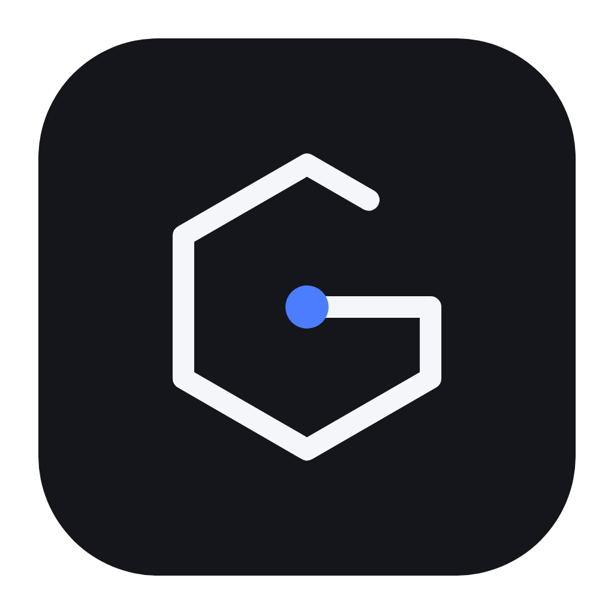
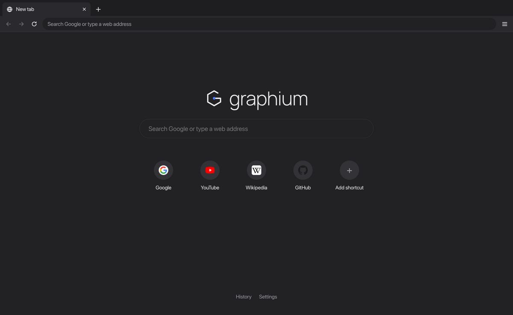

<p align="center">
  
</p>

<h1 align="center">Graphium</h1>

<p align="center">
  <strong>Light as air. Fast by nature.</strong>
  <br>
  A simple web browser that works like Chrome, with ads blocked out of the box.
  <br>
  <a href="https://github.com/Pascalllllll/Graphium-Browser/releases/latest"><strong>Download</strong></a>
  ·
  <a href="https://github.com/Pascalllllll/Graphium-Browser/issues/new/choose">Report a problem</a>
  ·
  <a href="CONTRIBUTING.md">Contribute</a>
</p>

<p align="center">
  <a href="LICENSE"></a>
  <a href="https://github.com/Pascalllllll/Graphium-Browser/releases/latest"></a>
  <a href="https://github.com/Pascalllllll/Graphium-Browser/actions/workflows/ci.yml"></a>
</p>



Graphium runs on Chromium, so websites, YouTube, Gmail and Google sign-in work
the same as in Chrome. Ads and trackers are blocked from the first page you
open, which makes pages faster and lighter.

No AI, no accounts, no telemetry. Free and open source (MIT license) for
Windows, macOS and Linux.

## Download

Version 1.0.0. Click a link and the download starts.

**Run without installing.** Download one file, open it, and Graphium runs.
Nothing is added to your system.

| Computer | Download |
| -------- | -------- |
| Windows  | [Graphium-1.0.0-win-x64-portable.exe](https://github.com/Pascalllllll/Graphium-Browser/releases/download/v1.0.0/Graphium-1.0.0-win-x64-portable.exe) |
| Linux (Intel/AMD) | [Graphium-1.0.0-linux-x86_64.AppImage](https://github.com/Pascalllllll/Graphium-Browser/releases/download/v1.0.0/Graphium-1.0.0-linux-x86_64.AppImage) |
| Linux (ARM) | [Graphium-1.0.0-linux-arm64.AppImage](https://github.com/Pascalllllll/Graphium-Browser/releases/download/v1.0.0/Graphium-1.0.0-linux-arm64.AppImage) |
| Mac      | Open the `.dmg` below and run Graphium straight from it, or drag it to *Applications* |

**Install.** Adds Graphium to your Start menu, Applications folder or app list.

| Computer | Download |
| -------- | -------- |
| Windows (Intel/AMD and ARM) | [Graphium-1.0.0-win-setup.exe](https://github.com/Pascalllllll/Graphium-Browser/releases/download/v1.0.0/Graphium-1.0.0-win-setup.exe) |
| Mac with Apple chip (M1 and newer) | [Graphium-1.0.0-mac-arm64.dmg](https://github.com/Pascalllllll/Graphium-Browser/releases/download/v1.0.0/Graphium-1.0.0-mac-arm64.dmg) |
| Mac with Intel chip | [Graphium-1.0.0-mac-x64.dmg](https://github.com/Pascalllllll/Graphium-Browser/releases/download/v1.0.0/Graphium-1.0.0-mac-x64.dmg) |
| Debian, Ubuntu, Mint (Intel/AMD) | [Graphium-1.0.0-linux-amd64.deb](https://github.com/Pascalllllll/Graphium-Browser/releases/download/v1.0.0/Graphium-1.0.0-linux-amd64.deb) |
| Debian, Ubuntu, Mint (ARM) | [Graphium-1.0.0-linux-arm64.deb](https://github.com/Pascalllllll/Graphium-Browser/releases/download/v1.0.0/Graphium-1.0.0-linux-arm64.deb) |
| Linux, unpack and run | [x64 .tar.gz](https://github.com/Pascalllllll/Graphium-Browser/releases/download/v1.0.0/Graphium-1.0.0-linux-x64.tar.gz) · [arm64 .tar.gz](https://github.com/Pascalllllll/Graphium-Browser/releases/download/v1.0.0/Graphium-1.0.0-linux-arm64.tar.gz) |

Checksums are in
[SHA256SUMS.txt](https://github.com/Pascalllllll/Graphium-Browser/releases/download/v1.0.0/SHA256SUMS.txt).
Older versions are on the
[Releases page](https://github.com/Pascalllllll/Graphium-Browser/releases).

The first time you open it:

- **Windows:** if a blue "Windows protected your PC" box appears, click
  *More info*, then *Run anyway*.
- **Mac:** right-click the app, choose *Open*, then *Open* again. If it says
  the app is damaged, run `xattr -cr "/Applications/Graphium.app"` in
  Terminal once.
- **Linux AppImage:** `chmod +x Graphium-*.AppImage`, then double-click it.
- **Debian, Ubuntu, Mint:** double-click the `.deb` to install it, or run
  `sudo apt install ./Graphium-*.deb` in a terminal. Graphium then shows up
  in your app list.
- **Linux .tar.gz:** unpack it, then run `./graphium` inside the folder.

These warnings appear because the app isn't signed with a paid certificate.

What changed in each version is in [CHANGELOG.md](CHANGELOG.md).

## Using it

It works like Chrome:

- Type a web address or a search in the bar at the top. As you type, it
  finishes sites you've visited before (`yo` becomes `youtube.com`); press
  `Enter` to go, or `Delete` to drop the suggestion.
- Click the **star** to put a page on your new tab page. Click it again to
  remove it.
- **History** is in the menu, or press `Ctrl+H`.
- Press `Ctrl+K` for the **command palette**: one box to switch tabs, reopen
  closed ones, open bookmarks and history, run any browser action, or do quick
  sums like `12*7`. Start with `>` for actions only. `Ctrl+Shift+A` searches
  just your tabs.
- `Ctrl+Shift+S` puts two tabs **side by side**. The address bar follows the
  side you click; picking another tab, or the shortcut again, ends it.
- The **shield** shows how many ads were blocked. If a site doesn't work right,
  click the shield to allow ads on that site.
- If a site asks for your camera, microphone or location, Graphium asks you once
  and remembers your answer.

## Light on memory

- Tabs you haven't looked at for 10 minutes go to sleep and give their memory
  back. Click a sleeping tab and it comes back where you left it. Tabs playing
  sound never sleep.
- If your computer runs low on memory, every background tab sleeps right away.
- Tabs on the same site share one process.
- Blocking ads means less to download and run on every page.

Measured with 7 busy tabs open on Linux: about 1,870 MB at first, and about
980 MB once the background tabs are asleep.

## Settings

Open **Menu → Settings**. Up front: search engine (Google by default), what
opens at startup, default browser, light or dark theme, color, ad blocking,
clearing your data, and the download folder. Everything else is under
*Advanced*.

## Keyboard shortcuts

On a Mac use `Cmd` instead of `Ctrl`.

| Action                    | Keys                              |
| ------------------------- | --------------------------------- |
| New tab / window          | `Ctrl+T` / `Ctrl+N`               |
| New private window        | `Ctrl+Shift+N`                    |
| Close tab                 | `Ctrl+W`                          |
| Reopen closed tab         | `Ctrl+Shift+T`                    |
| Next / previous tab       | `Ctrl+Tab` / `Ctrl+Shift+Tab`     |
| Address bar               | `Ctrl+L`                          |
| Back / forward            | `Alt+Left` / `Alt+Right`          |
| Reload                    | `Ctrl+R` or `F5`                  |
| Find in page              | `Ctrl+F`                          |
| History / downloads       | `Ctrl+H` / `Ctrl+J`               |
| Add page to new tab       | `Ctrl+D`                          |
| Zoom in / out / reset     | `Ctrl+=` / `Ctrl+-` / `Ctrl+0`    |
| Full screen               | `F11`                             |

## How it is built

Graphium is an [Electron](https://www.electronjs.org) app: Chromium plus a small
browser shell in plain HTML, CSS and JavaScript, with no frameworks and no
build step.

```
src/main.js        windows, tabs, ad blocking, permissions, downloads, memory
src/history.js     history and address bar completion
src/settings.js    settings file with validation
src/ui/            the tab strip and toolbar
src/pages/         new tab, settings, history and error pages
test/              checks that drive the real browser
```

## Limits

- The download is about 100 MB, because it includes the whole Chromium engine.
- There is no automatic updater. Get new versions from the Releases page.
- No Chrome extensions, sync or password manager. They were left out to keep
  it light and simple.

## Privacy

Graphium doesn't collect anything about you and has no analytics. Your
history, settings and site permissions stay on your computer. The only
requests Graphium makes on its own are the ad block list updates (every
few days) and the search engine you pick. See [PRIVACY.md](PRIVACY.md).

## Contributing

Bug reports, fixes and translations are welcome. Read
[CONTRIBUTING.md](CONTRIBUTING.md) to get started, and report security
problems privately as described in [SECURITY.md](SECURITY.md).

## License

Graphium is released under the [MIT license](LICENSE). The name, logo and
brand sheets in [docs/brand](docs/brand) belong to the project; please don't
use them for forks in a way that suggests they are the official Graphium.
The new tab page uses the [Manrope](https://github.com/sharanda/manrope) font
(SIL Open Font License).

It is built on [Electron](https://www.electronjs.org) (MIT) and Chromium
(BSD-style license), and blocks ads with
[Ghostery's adblocker](https://github.com/ghostery/adblocker) (MPL-2.0),
which uses community filter lists such as EasyList and EasyPrivacy.
Graphium is not affiliated with Google, Ghostery or the Electron project.
